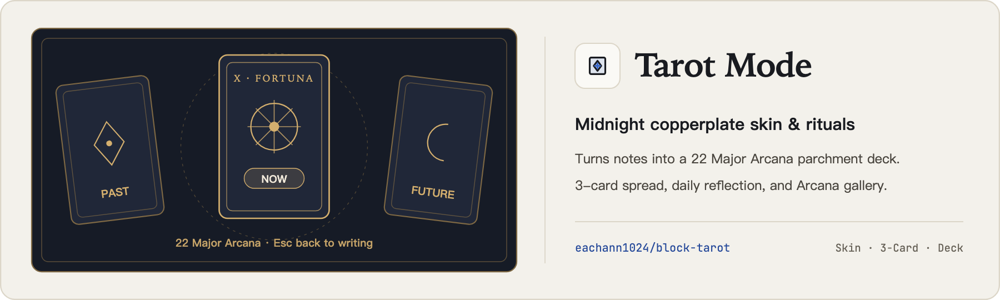

<picture>
  <source media="(prefers-color-scheme: dark)" srcset="assets/card-en-dark.png">
  <source media="(prefers-color-scheme: light)" srcset="assets/card-en-light.png">
  
</picture>

Dress Block in a retro dark-gold Tarot theme, paired with a daily prompt card tool like a mindful journaling deck.

- **Full interface theme**: Styles the main editor, sidebar, AI area, and Quick Note window together so you can keep writing in the mood.
- **Card prompts on hand**: Includes a Daily Card reflection prompt, a Past / Now / Future 3-card spread, and a 22-card Major Arcana gallery.
- **Easy in, easy out**: Toggle anytime from the top-bar moon button or Command Palette, and press `Esc` to jump right back to your cursor without touching your notes.

**Install**: Open Block Settings -> App Store and search **Tarot Mode**, or enter `blockmd-plugins/block-tarot`.
