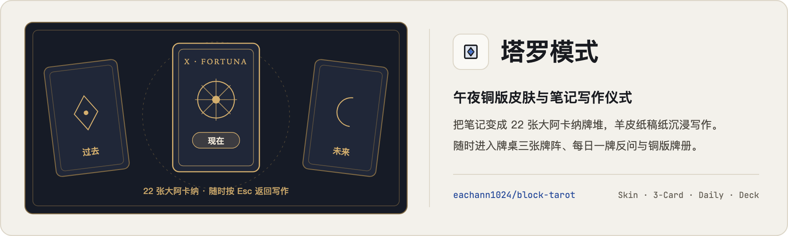

<picture>
  <source media="(prefers-color-scheme: dark)" srcset="assets/card-zh-dark.png">
  <source media="(prefers-color-scheme: light)" srcset="assets/card-zh-light.png">
  
</picture>

- **午夜铜版换肤**：羊皮纸写作台、卡组侧栏、AI 显影牌与速记牌脊，开启即生效且不打断写作。
- **三大仪式房间**：牌桌三张牌阵（过去/现在/未来）、每日一牌正逆位反问、22 张大阿卡纳牌册图鉴。
- **来去自由**：顶栏月亮按钮或命令面板一键切换，按 `Esc` 立刻回到原光标位置。

**安装**：打开 Block「设置 → 应用商店」搜索 **塔罗模式**，或手动填入 `eachann1024/block-tarot`。
